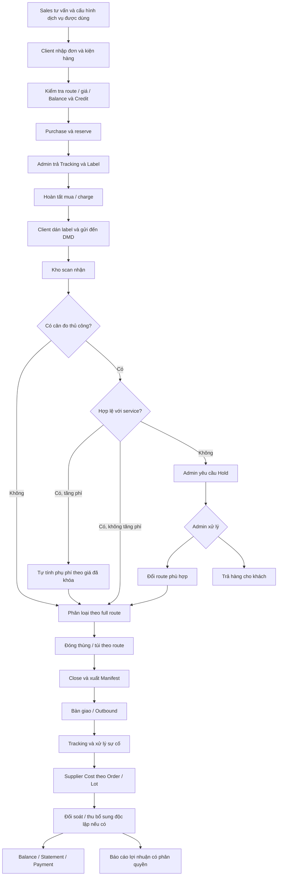
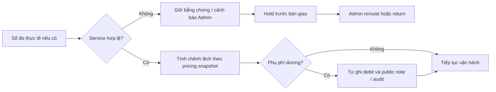
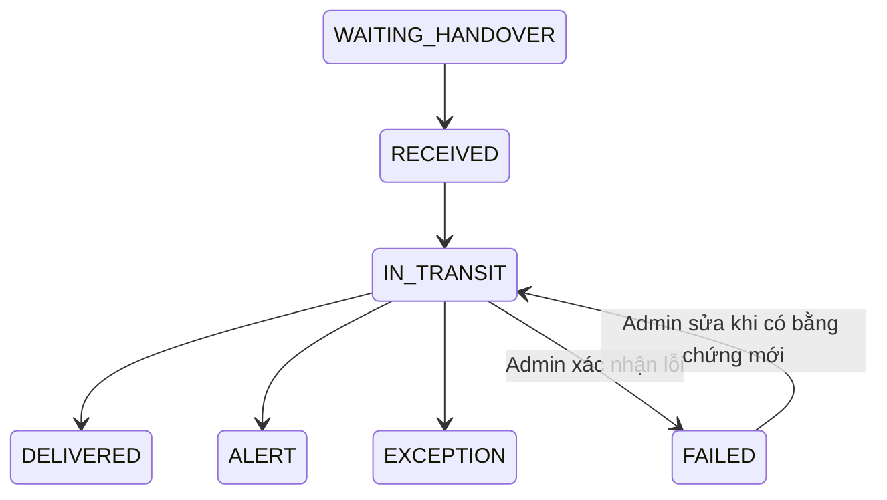
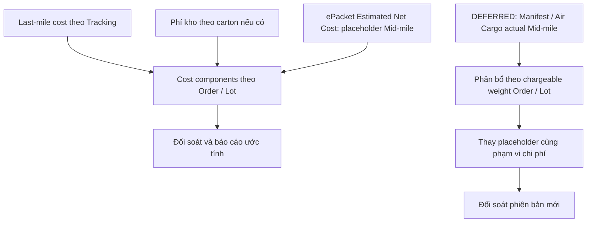

# DMD Report — Luồng vận hành và business rules

## Payment Adjustment application continuation — 20/10/2026

Finance can now append linked actual-receipt adjustments through the Payment Reconciliation UI/API. Original Payment and adjustment ledger/history are immutable; reductions consume the Payment's Balance portion, then reverse principal and interest; increases settle current Debt interest/principal before surplus. Client/Sales notifications, optimistic versions and atomic actor-scoped receipts are implemented. Existing Payment allocations into Statements are **blocked pending reviewed migration**; the global legacy FIFO and Statement-dependent Debt conversion remain. This is a verified partial delivery, not completion of the Owner financial cutover. See [Payment feature](15-payment-reconciliation.md) and [current evidence](VERIFICATION-PAYMENT-ADJUSTMENTS-2026-10-20.md).

## Payment reconciliation continuation — 20/10/2026

Finance bulk confirmation/discrepancy is connected to real Payment ledger rows through a dedicated API and UI. It appends immutable reconciliation history, atomic Client/Sales notifications and optimistic version checks without moving money or allocations. Payment Adjustment and the approved Payment/Debt/Statement cutover remain incomplete. See [Payment reconciliation](15-payment-reconciliation.md) and [verification/migration/UAT](VERIFICATION-PAYMENTS-2026-10-20.md).

## Owner financial update — 20/10/2026

Current implemented flow: Claim decision/revision → signed Client Refund Balance → explicit Finance actual payout to Balance OR Bank; negative refund exposure permits explicit Admin recovery only. Dedicated refund reports and notifications are connected. Payment/Debt/Statement workflows below remain legacy and require the approved cutover. See [Refund Management](14-refund-management.md) and [continuation evidence](VERIFICATION-REFUNDS-2026-10-20.md).

## Delta Owner trong lượt kiểm tra 17–18/10/2026
Owner chọn BOD/FINANCE là role riêng: được xem/nhập Supplier Cost, đối soát, invoice/payment Supplier, không quyền Admin khác. Owner chọn bảng Base Rate được duyệt và chặn mua khi chưa cấu hình, không suy từ Net. Code ePacket đã có gate; route manual khác vẫn là gap. Chi tiết hiện hành: feature 01, 03 và VERIFICATION-COMMIT-2026-10-18.md. Tài liệu nguồn export trong project sources giữ nguyên; bản đó chưa chứa D24–D26.

**Nguồn chuẩn nghiệp vụ: phản hồi Owner ngày 16/10/2026.** Chỉ Owner và ChatGPT phát triển source. Tài liệu này điều phối các feature bên dưới; khi khác biệt với quyết định cũ, delta 16/10 được ưu tiên. Không coi code khác spec là quyết định nghiệp vụ mới.

- **IMPLEMENTED**: đã tìm thấy hành vi trong source; không đồng nghĩa nghiệm thu UI hay production.
- **APPROVED**: Owner đã chốt, nhưng code còn thiếu hoặc mới đáp ứng một phần.
- **DEFERRED**: chủ động để sau; không phải điều kiện hoàn thành chức năng GĐ1 hiện tại.
- Một hàng có thể chứa nhiều phần, mỗi phần có trạng thái riêng. Kết quả kiểm thử được ghi riêng trong báo cáo verification.

## 1. Bản đồ tổng thể

Sơ đồ biểu diễn **luồng nghiệp vụ đã chốt**, gồm cả bước APPROVED chưa hoàn tất; xem bảng đối chiếu ở mục 7 trước khi sử dụng.

Cân đo tại kho là **thủ công và KHÔNG bắt buộc**. Dữ liệu cân/kích thước khách khai để báo giá vẫn cần theo rule dịch vụ; không nhầm dữ liệu khai báo với yêu cầu đo lại tại kho. Không thêm gate “phải MEASURED mới được đóng thùng/xuất hàng”.

## 2. Chọn dịch vụ, mua đơn và thu tiền

- Sales tư vấn rồi cấu hình dịch vụ/sub-service và chiết khấu cho mỗi Client; khách thường dùng 1–2 dịch vụ. Không mở toàn bộ catalog cho mọi khách.
- ePacket Standard/Eco, Yun Express, UPS theo rule route thực tế. Chuyên tuyến xử lý case-by-case với đối tác, vẫn đăng ký Supplier vào full route để kho chuyển đúng nơi. Tư vấn thương mại không thay thế eligibility trong bảng giá từng route.
- Express hoàn tất mua khi có Tracking + Label hợp lệ; reserve và charge là hai thời điểm khác nhau. Lỗi purchase/retry không được ghi tiền trùng.
- Base Rate → Retail → Sales Price độc lập với Estimated/Actual Net Cost. Supplier cost đến muộn không tự đổi giá bán đã khóa.
- Khách nạp Balance hoặc có Credit; quá hạn/khóa mua chặn Purchase. Debt là khoản quản lý riêng, không tạo Payment giả khi chuyển nợ. Payment ghi đúng ví thực nhận và phân bổ Debt trước theo rule đã chốt.
- Chính sách huỷ theo route/Supplier và trạng thái: đủ điều kiện tự xử lý; huỷ label ở Supplier, huỷ nội bộ và refund là các kết quả phải phân biệt.

Đặc tả: [Client/RBAC](01-auth-rbac.md), [Orders](02-orders-drafts.md), [Pricing](03-service-route-pricing.md), [Purchase](04-purchase-engine.md), [Cancellation](06-cancellation.md), [Finance](08-finance-balance.md).

## 3. Kho và phụ phí cân đo

**APPROVED:** trội cân hợp lệ tự động tính phụ phí khách, không cần confirm lại và không cần Sales/Admin duyệt lần hai. Đây là khoản theo số đo, khác phụ phí do chênh lệch Supplier Actual Cost trong Reconciliation (D15 vẫn có Admin xử lý).

- Giữ riêng declared/measured data; không ghi đè khai báo hoặc snapshot mua.
- Khi triển khai auto debit phải kiểm thử đo lại/retry không thu trùng; chỉ thu chênh lệch chưa thu. Không suy ra refund tự động khi đo giảm.
- Vượt giới hạn service là lỗi dịch vụ, cần Admin hold, đổi route hoặc trả hàng; không tiếp tục như một khoản phụ phí bình thường.
- Route chưa có bảng giá/limits đủ để tính tự động phải báo rõ thiếu cấu hình, không tự đoán giá hay coi là hợp lệ.
- Reroute phải kiểm lại quyền dịch vụ, giá, label cũ/mới và chi phí; không lặng lẽ đổi route của đơn đã khóa.

**IMPLEMENTED local 16/10 — phạm vi ePacket Standard/Eco DMD có snapshot/bảng giá khóa:** cân đo hợp lệ tự ghi WEIGHT_ADJUSTMENT debit phần dương chưa thu, kèm public note/audit trong transaction; cùng tier nhưng phát sinh phí chiều dài vẫn được tính. Đo lại cùng/thấp hơn không thu trùng/không tự refund. Giá bán/snapshot giữ nguyên; ledger nối statement, refundable total và revenue đối soát. Quote ngoài service hoặc thiếu phiên bản giá giữ measurement và tạo Case HOLD; chỉ Admin được đóng Hold. Cân đo vẫn không bắt buộc.

**APPROVED chưa hoàn tất:** route chưa có giá version vẫn cần báo giá thủ công theo luồng legacy; D19 chưa phủ UPS/Yun/custom. Không dùng công thức ePacket cho route khác. Hold/evidence đã có nhưng chưa hoàn tất reroute/đổi label/return end-to-end. Không tự đóng Hold khi đo lại hợp lệ hoặc xóa bằng chứng cũ. Pending adjustments lịch sử không tự charge khi khởi động.

**IMPLEMENTED:** `warehouse-guard.ts` không bắt buộc measurement; chặn hold/cancel/sai full route. Manifest theo Service + Sub-Service + Supplier; East/West mặc định OFF.

Định tuyến vận hành đã chốt: Standard US và Eco US đóng riêng; ePacket EU/Yun chuyển SGB; UPS chuyển SBay; Chuyên tuyến theo đối tác đã gắn route. Giá trị cấu hình thực tế vẫn phải đối chiếu trước UAT. Manifest xuất trước bàn giao; nhãn carton nội bộ hỗ trợ định danh. Auto mua label UPS US cho carton Eco và tách bờ Đông/Tây: DEFERRED.

Đặc tả: [Warehouse & Manifest](07-warehouse-manifest.md), [Cases](10-operations-cases-claims.md).

## 4. Tracking khác Case

Sơ đồ là hành trình điển hình, không phải ma trận cấm mọi chuyển trạng thái khác. API vẫn cho Admin cập nhật các status hợp lệ trên Tracking ACTIVE có ETD và Order mở.

**IMPLEMENTED 16/10:** thêm shipment `FAILED` vào API, dropdown và tab lọc riêng; FAILED bị loại khỏi queue Theo ETD/active cùng Delivered/Alert/Exception. ETD, query và service filter giữ nguyên. Cập nhật có actor/history; không tự refund hoặc đổi Case.

`FAILED` của shipment khác purchase reserve `FAILED`. Case kết thúc (giao diện có thể gọi Solved, code `RESOLVED`/`CLOSED`) chỉ là hoàn tất xử lý hồ sơ; không đồng nghĩa giao thành công hoặc tự đưa tracking về IN_TRANSIT. Claim/refund vẫn là quyết định tiền riêng. Không tự chuyển các đơn IN_TRANSIT lâu ngày sang FAILED, không backfill đoán lỗi.

Đặc tả: [Tracking](05-tracking-label.md), [Cases & Claims](10-operations-cases-claims.md).

## 5. Chi phí, Mid-mile và đối soát

**IMPLEMENTED local — component/coverage model; APPROVED — hoàn thiện mapping và acceptance:** ePacket dùng Estimated Net Cost làm placeholder Mid-mile trong giai đoạn hiện tại. Phải xác định phạm vi của estimate trước khi cộng last-mile/phí kho: nếu estimate đã bao gồm khoản đó thì không cộng lần nữa. Không cộng toàn bộ estimate vào Actual Net đang chứa cùng chi phí.

**DEFERRED:** Cargo/Mid-mile thực tế từ manifest/air cargo phân bổ về từng Order/Lot theo trọng số chargeable weight: `allocation_i = shipment_mid_mile_cost × chargeable_weight_i / sum(chargeable_weight)`. Công thức là nguyên tắc đã chốt; rounding/residual, split manifest, thiếu/zero weight, FX, late invoice và reversal phải đặc tả trước khi code. Giữ chứng từ nguồn và khóa chống phân bổ trùng; tổng phân bổ phải bằng chứng từ. Khi actual được phân bổ thì thay placeholder tương ứng, không cộng chồng. Chưa tự kích hoạt module Cargo.

**As-is đã đối chiếu lại 16/10:** `reconciliation.ts` có `LAST_MILE`, `MID_MILE`, `WAREHOUSE`, `OTHER` theo Lot, nhập qua action `cost_components` với reason/request_key và đủ bốn thành phần. Effective cost dùng actual nếu có, fallback estimate phần còn thiếu; actual bằng 0 khác null. Actual thay estimate cùng thành phần, không cộng chồng. Thiếu actual → PARTIAL; đủ actual → COMPLETE. Aggregate ePacket chưa rõ mapping → UNKNOWN và effective cost null. Không trộn aggregate supplier feed với component model.

Đối soát theo Lot vẫn Pass/Review/Pending; GP finalized chỉ khi mọi Lot PASS **và** coverage COMPLETE. PASS riêng không chứng minh fully actual. Snapshot component/coverage đi cùng version; không tự phân rã hay backfill dữ liệu lịch sử. Các báo cáo/export cũ chưa được chứng minh áp dụng coverage đầy đủ.

**Warehouse:** IMPLEMENTED chỗ chứa cost và reference carton/order trong component theo Lot; APPROVED về quy tắc xử lý theo Carton/Order. Chưa thấy bộ tính/phân bổ tự động phí kho theo số carton/order; reference dạng text không phải liên kết carton có ràng buộc FK. Last-mile reference cũng không tự chứng minh có adapter mapping Tracking → component. GĐ1 UI vẫn hai tổng Estimated/Actual; không yêu cầu người dùng nhập bốn thành phần. Cần mapping nguồn chi phí, FX và cách ghi nhận khoản không áp dụng trước acceptance.

Bằng chứng: [cost coverage verification](VERIFICATION-COST-COVERAGE-2026-10-16.md), `reconciliation.ts`, `finance.ts`; lần rà soát này chạy lại 58 checks Debt/Reconciliation PASS.

D03/D15 vẫn đúng cho Supplier Cost: cost feed không tự thu thêm tiền khách; Admin chọn surcharge có public note hoặc absorb loss. Rule auto surcharge cân đo ở mục 3 là trigger khác.

Đặc tả: [Supplier Reconciliation](09-supplier-reconciliation.md), [Pricing](03-service-route-pricing.md).

## 6. Bảo mật lợi nhuận và Supplier account

**APPROVED — release blocker:** GP-Net chỉ BOD/authorized finance; Sales, Admin vận hành, CSKH thông thường không được xem. Không đồng nhất ADMIN với BOD. Cần bảo vệ API/detail/list/export/dashboard, pricing snapshot và derived margin/cost có thể suy ra Net. Ẩn cột UI không đủ. GP-Base phục vụ Sales là chỉ tiêu riêng.

**As-is xung đột:** `auth.ts` chỉ có ADMIN/SALES/CLIENT/WAREHOUSE; `orders/route.ts` trả payload đầy đủ cho ADMIN, `safePricing` cho ADMIN toàn quote, Reconciliation chỉ kiểm ADMIN; chưa có quyền BOD/finance chuyên biệt. **Đã sửa payload Orders local:** stripPricingInternals loại estimated_gp, estimated_margin_pct, finalized_gp, finalized_margin_pct, effective_net_cost, cost_coverage_json cho non-Admin ở list/detail/Sales create. RBAC regression API dùng giá trị non-null kiểm tra 65 assertions PASS. Đây chỉ đóng lỗ hổng đã xác định; ADMIN hiện vẫn có quyền Net và chưa đáp ứng D22. Chưa tự cấp quyền finance cho mọi Admin hay chuyển `is_root_admin` thành BOD khi chưa có ma trận quyền được chốt. Không xác nhận đáp ứng bảo mật trước khi sửa toàn bộ đường xuất dữ liệu và kiểm thử role.

**DEFERRED:** Supplier là account/login riêng, có phạm vi dữ liệu riêng cho balance, statements/công nợ, reconciliation, missing-cost, claims và payments. Supplier trong enum/route và Supplier Recovery hiện tại không phải Supplier portal. Không tái sử dụng Client Balance làm Supplier Balance.

**Supplier payables — APPROVED GĐ1 theo D24; IMPLEMENTED local:** Owner chọn đưa sổ invoice/thanh toán/còn phải trả vào hệ thống. Có invoice USD, partial/full payment allocation, outstanding theo Supplier, reversal, void invoice chưa trả, chứng từ/reason/audit và idempotency; không sinh lại Order cost hay trừ Client Balance. UI tại Supplier Costs & Phải trả. Portal/login Supplier vẫn DEFERRED. Quyền đang theo ADMIN Finance Controls, chưa đáp ứng tách BOD/finance D22; UAT/migration và mapping chứng từ cost chưa nghiệm thu. Xem [Supplier Payables](13-supplier-payables.md).

Permission spec cần trước triển khai: ai mời/khóa Supplier, user ↔ Supplier, xem/nhập cost hay được sửa, ai duyệt/phản hồi tranh chấp, xem chứng từ thanh toán, cách ly Supplier khác/Client pricing/GP, audit và export. Đây là việc còn thiếu đặc tả quyền, không phải logic Supplier account còn chưa được Owner đồng ý.

Đặc tả: [RBAC](01-auth-rbac.md), [Finance](08-finance-balance.md), [Reconciliation](09-supplier-reconciliation.md).

## 7. Đối chiếu triển khai và ưu tiên GĐ1

| Hạng mục | Trạng thái | Bằng chứng / việc tiếp theo |
|---|---|---|
| Client eligibility, reserve/charge | IMPLEMENTED local | `route-pricing.ts`, `credit.ts`, `order-operations.ts`; cần UAT từng route |
| Pricing Base Rate độc lập Net (D02) | APPROVED chưa hoàn tất | ePacket quote vẫn net → base/retail, chưa có bảng Base Rate riêng; snapshot không tự đổi khi supplier cost tới không thay thế D02 |
| Kho không bắt buộc cân đo lại | IMPLEMENTED | `warehouse-guard.ts` không có gate MEASURED |
| Auto surcharge cân hợp lệ | IMPLEMENTED local ePacket có giá khóa; APPROVED các route khác | Auto delta, retry/remeasure, audit rollback; legacy manual chưa đổi |
| Vượt service → Admin hold/reroute/return | IMPLEMENTED evidence/Hold ePacket; APPROVED reroute/return | Số đo được lưu, chặn outbound; đổi route/label/return chưa end-to-end |
| Shipment FAILED và filter | IMPLEMENTED | `shipment-status/route.ts`, `order-workspaces.tsx`, `verify-rbac.cjs` |
| Debt/payment allocation; Lot reconciliation | IMPLEMENTED | `credit.ts`, `debt-interest.ts`, `reconciliation.ts`; UAT/migration còn thiếu |
| Component/placeholder Mid-mile | IMPLEMENTED local; APPROVED mapping/UAT | Fallback estimate, actual thay cùng phần, PARTIAL/COMPLETE/UNKNOWN; không trộn aggregate; chưa Cargo allocation |
| Warehouse theo Carton/Order | IMPLEMENTED chỗ lưu; APPROVED flow tính phí | Component theo Lot có reference; chưa tự tính/phân bổ theo carton/order |
| Supplier payables | APPROVED GĐ1, IMPLEMENTED local | Invoice/payment/allocation/outstanding/reversal/audit; quyền finance/UAT còn pending; portal DEFERRED |
| GP-Net restricted BOD/finance | APPROVED | Permission model và mọi đường đọc/export cần sửa trước launch |
| Actual Mid-mile allocation / Cargo | DEFERRED | Sau GĐ1; không đưa vào acceptance GĐ1 |
| Supplier login/portal/Balance/Statements | DEFERRED | Lập permission spec trước triển khai |

Thứ tự tiếp tục GĐ1:
1. Giữ baseline kiểm thử DB tạm; sửa quyền GP-Net và rò các trường tài chính mới ở API/list/detail/export/dashboard; regression theo Sales/Client/Warehouse/Admin vận hành/BOD-finance sau khi chốt ma trận quyền.
2. Hoàn thiện measurement → auto surcharge hoặc evidence/hold/reroute/return; kiểm tra retry, đo lại, reserve/charge/refund và giá đã khóa.
3. Nghiệm thu cost components: mapping Last-mile/Tracking, Mid-mile estimate fallback/replacement, Warehouse Carton/Order và Other; FX/coverage/lịch sử/report/export. Không triển khai actual Cargo allocation GĐ1.
4. UAT sổ phải trả Supplier GĐ1 với invoice/thanh toán thực tế đã được mô phỏng; nghiệm thu đối chiếu chứng từ, quyền finance và backup/rollback. Portal vẫn sau GĐ1.
5. Chốt policy cancellation từng route/Supplier và quy trình huỷ label thực tế; UAT Claim refund từng Order, compensation, Supplier Recovery và chống refund trùng khi Claim chồng Cancellation.
6. Chuẩn bị migration trên bản sao DB đã backup: schema rerun, Debt legacy, Claim thiếu allocation, pending cancellation recheck, aggregate/component mapping, GP lịch sử; kiểm tra tổng tiền/audit trước-sau và phục hồi. Không tự sửa số lịch sử hay chạy DB thật.
7. Chạy regression phù hợp, production build trên DB tách biệt và browser UAT đầu-cuối từng role/route với dữ liệu đã migration thử; ghi biên bản, xử lý blocker rồi chạy lại phần bị ảnh hưởng.
8. Review diff và links, loại bản sao/cache/DB/secrets khỏi staging; commit phần đã nghiệm thu. Push chỉ khi Owner yêu cầu; deploy là bước riêng sau nghiệm thu và kế hoạch backup/rollback. Lượt rà soát này không commit/push/deploy.

Cargo được Owner nói là GĐ2 trong phản hồi mới, roadmap cũ gọi GĐ3 (GĐ2 dành Label integration). Ghi nhận là **giai đoạn sau GĐ1, số thứ tự cần thống nhất khi lập kế hoạch tiếp**, không đổi ngầm thứ tự tích hợp Label.

## 8. Kiểm chứng và giới hạn

Xem [verification 16/10](VERIFICATION-2026-10-16.md) cho kết quả chạy thực tế. Automated tests dùng database tạm; không migrate/reset dữ liệu thật, không deploy/push production. Browser UAT, policy Supplier thực tế và dữ liệu migration chưa được nghiệm thu. Các kết quả 747 checks của ngày trước không thay thế kết quả lần này.

## 9. Rà soát tài liệu 16/10/2026
- Lượt tiếp tục đã tìm thấy bản xuất tại `/Users/quan/Documents/Codex/2026-10-16/referenced-chatgpt-conversation-this-is-an-3/outputs/DMD_Report_Operational_Flow_Business_Rules_2026-10-16.md`. Nội dung là bản xuất canonical trước lượt tiếp tục (khác cách ghi link tuyệt đối); các ghi chú chưa tìm thấy file trong báo cáo cũ là lịch sử. Bản xuất cũ nay thiếu D24 và các sửa code mới; canonical trong repository là bản hiện hành.
- Các câu “chưa có component model” ở bản Operational Flow trước lần sửa này đã lỗi thời; thay bằng trạng thái triển khai local và các giới hạn mapping/coverage ở mục 5.
- Verification cũ là kết quả tại thời điểm ghi; các delta mới hơn và [báo cáo rà soát](AUDIT-OPERATIONAL-FLOW-2026-10-16.md) được ưu tiên khi đánh giá trạng thái hiện tại.

## 10. Kết quả lượt tiếp tục
Xem [Verification continuation](VERIFICATION-CONTINUATION-2026-10-16.md) cho source/tests/UI hiện tại. Các báo cáo trước giữ làm lịch sử, không thay bằng chứng lượt mới.
